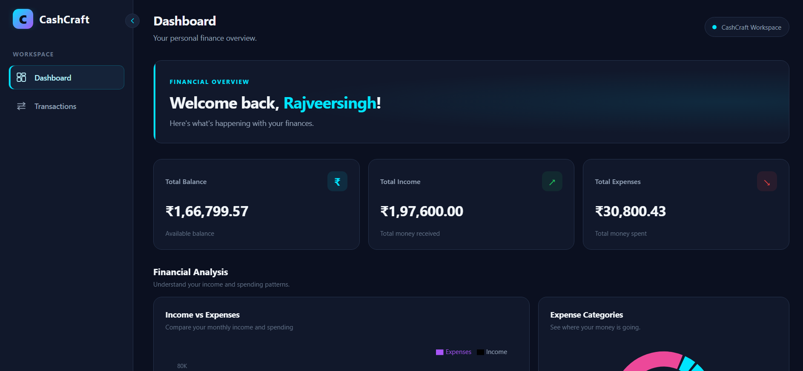
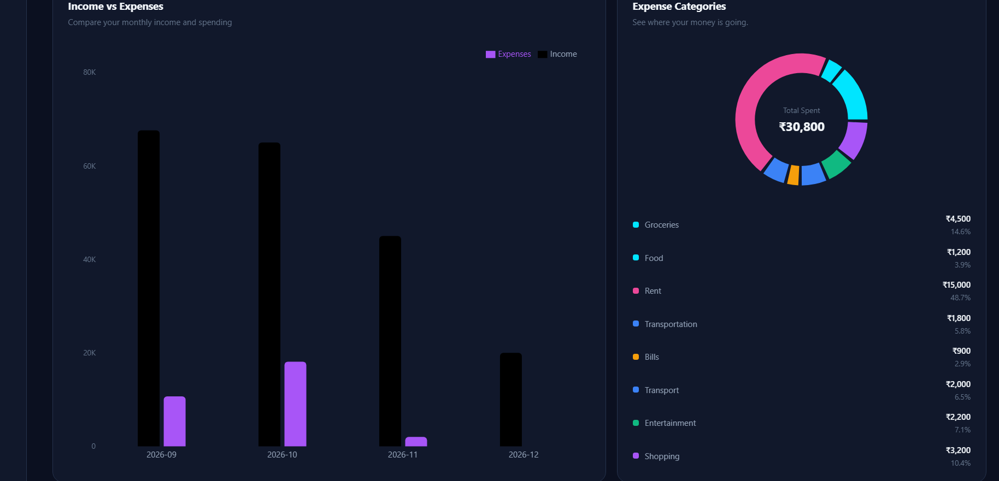
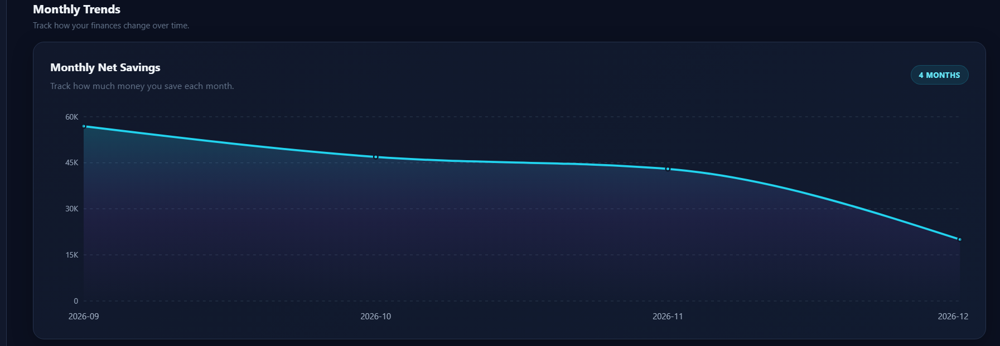
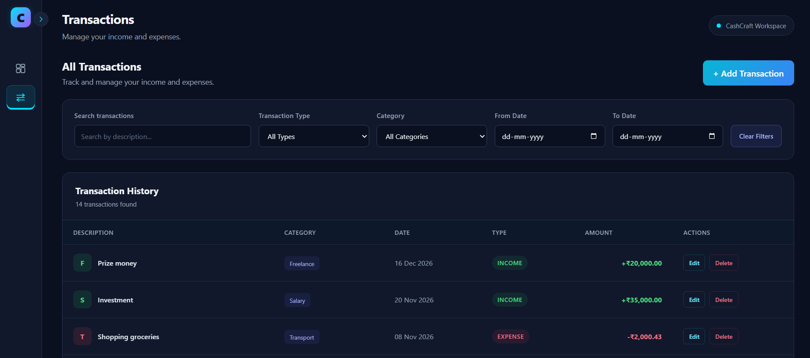
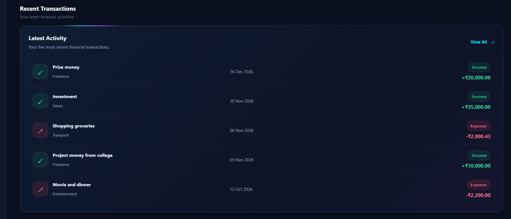
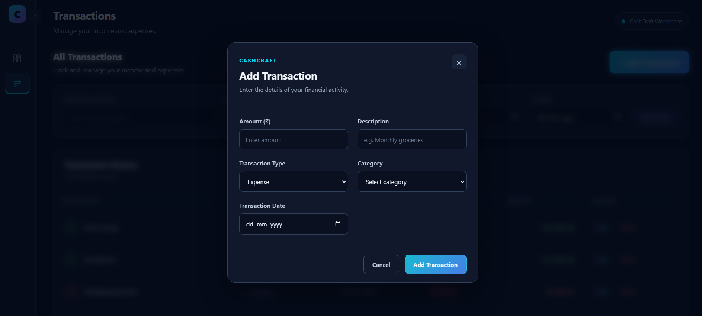
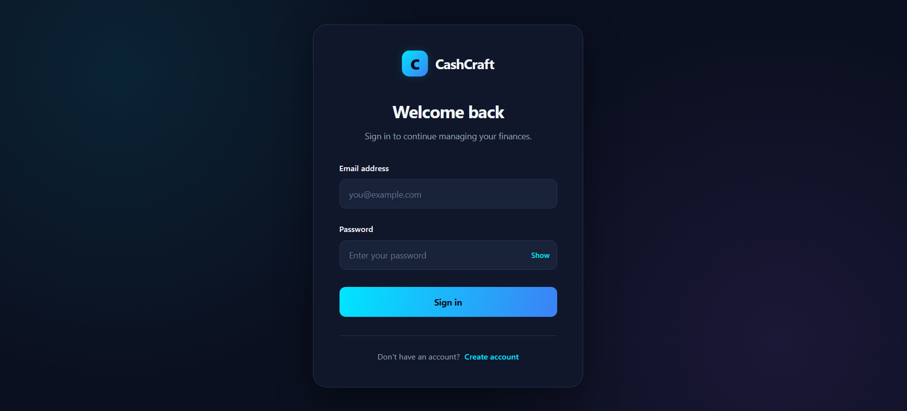
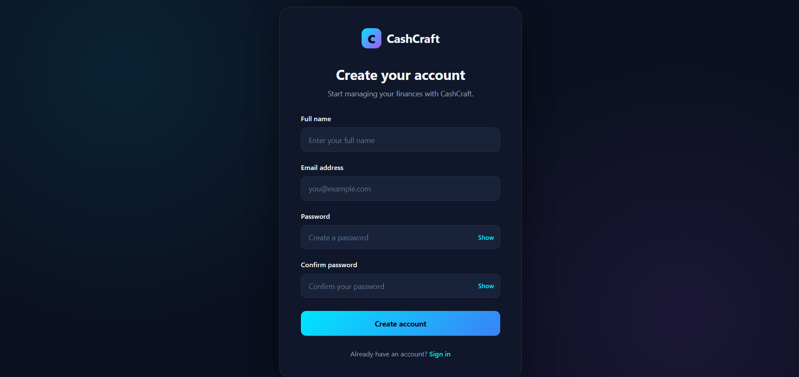
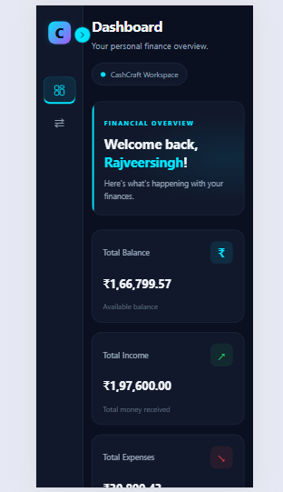

# CashCraft — Personal Finance Management System

**A full-stack personal finance application built to help users track income, manage expenses, and understand their financial activity through an interactive dashboard.**

<p align="center">

**Built with React · Spring Boot · PostgreSQL**

</p>

---

## About the Project

CashCraft is a full-stack personal finance management application designed to provide users with a centralized platform for recording, organizing, and monitoring their financial transactions.

The application allows users to register securely, authenticate using JWT-based authentication, manage income and expense transactions, categorize financial activities, and monitor their financial position through an interactive dashboard.

The project follows a frontend-backend architecture, with a React-based user interface communicating with RESTful APIs developed using Spring Boot. PostgreSQL is used for persistent data storage.

CashCraft was developed with an emphasis on clean application architecture, secure authentication, maintainable code, responsive UI design, and practical full-stack development principles.

---

## Application Screenshots

### Dashboard

The main dashboard provides an overview of the user's financial activity, including income, expenses, balance, and recent transactions.



### Financial Analysis

Visual representation of income and expense distribution across different categories.



### Monthly Trends

Track monthly income and expenses through financial trend visualizations.



### Transaction Management

View and manage financial transactions with filtering and transaction management options.



### Recent Transactions

A quick overview of the user's latest financial activities.



### Add / Edit Transaction

Create or update income and expense records using the transaction form.



### User Authentication

| Login                                | Registration                               |
| ------------------------------------ | ------------------------------------------ |
|  |  |

### Responsive Design

CashCraft adapts its interface to smaller screens for a consistent mobile experience.



## Key Features

### Authentication and Security

- User registration with name, email, and password.
- Secure password hashing using BCrypt.
- User login with JWT-based authentication.
- Protected backend endpoints using Spring Security.
- Token-based authorization for authenticated requests.
- Session-based token storage using browser `sessionStorage`.
- Automatic authentication token attachment through Axios interceptors.

### Transaction Management

- Create income and expense transactions.
- View transaction history.
- Edit existing transactions.
- Delete transactions.
- Categorize transactions.
- Filter transactions based on available transaction criteria.
- Store transaction amounts, dates, descriptions, types, and categories.

### Financial Dashboard

- Overview of total income, expenses, and balance.
- Income and expense category breakdowns.
- Monthly financial summaries.
- Income-versus-expense visualization.
- Monthly financial trend visualization.
- Recent transaction overview.

### User Interface and Experience

- Modern dark-themed financial dashboard.
- Responsive layouts for desktop, tablet, and mobile screens.
- Collapsible sidebar navigation.
- Reusable React components.
- Add and edit transaction forms.
- Delete confirmation modal.
- Toast notifications for user feedback.
- Loading, empty, and error-state handling.

---

## Technology Stack

| Layer              | Technologies                   |
| ------------------ | ------------------------------ |
| Frontend           | React, JavaScript, HTML5, CSS3 |
| Frontend Tooling   | Vite, ESLint                   |
| Routing            | React Router DOM               |
| HTTP Client        | Axios                          |
| Data Visualization | Recharts                       |
| Backend            | Java 21, Spring Boot 4         |
| Backend Security   | Spring Security, JWT           |
| Password Security  | BCrypt                         |
| Persistence        | Spring Data JPA, Hibernate     |
| Database           | PostgreSQL                     |
| Build Tool         | Maven                          |
| API Testing        | Postman                        |
| Version Control    | Git and GitHub                 |

---

## Application Architecture

CashCraft follows a client-server architecture with a React frontend, Spring Boot REST API backend, and PostgreSQL database.

```text
                 USER
                   |
                   v
          REACT FRONTEND
          (React + Vite)
                   |
                   v
             AXIOS CLIENT
          (HTTP Requests)
                   |
          JWT Authorization
                   |
                   v
          SPRING BOOT BACKEND
                   |
          SPRING SECURITY
          (JWT Validation)
                   |
                   v
             REST CONTROLLERS
                   |
                   v
             SERVICE LAYER
          (Business Logic)
                   |
                   v
           REPOSITORY LAYER
             (Spring Data JPA)
                   |
                   v
             POSTGRESQL
              DATABASE
```

### Request Flow

1. The user interacts with the React frontend.
2. React components invoke the appropriate service methods.
3. Axios sends HTTP requests to the Spring Boot backend.
4. The Axios request interceptor attaches the JWT token when available.
5. Spring Security validates authentication for protected endpoints.
6. Controllers process incoming requests and delegate business operations to service classes.
7. Repository classes interact with PostgreSQL through Spring Data JPA.
8. The backend returns the appropriate HTTP response.
9. React updates the interface based on the response.

---

## Project Structure

The repository is organized into separate frontend and backend applications.

```text
CashCraft/
│
├── backend/
│   ├── src/
│   │   └── main/
│   │       ├── java/
│   │       │   └── .../
│   │       │       ├── config/
│   │       │       ├── controller/
│   │       │       ├── dto/
│   │       │       ├── entity/
│   │       │       ├── exception/
│   │       │       ├── repository/
│   │       │       ├── security/
│   │       │       └── service/
│   │       │
│   │       └── resources/
│   │           └── application.properties
│   │
│   └── pom.xml
│
├── frontend/
│   ├── public/
│   ├── src/
│   │   ├── components/
│   │   │   ├── common/
│   │   │   ├── dashboard/
│   │   │   ├── layout/
│   │   │   └── transactions/
│   │   │
│   │   ├── layouts/
│   │   ├── pages/
│   │   ├── services/
│   │   ├── assets/
│   │   ├── App.jsx
│   │   ├── App.css
│   │   └── index.css
│   │
│   ├── .env
│   ├── package.json
│   └── vite.config.js
│
├── .gitignore
└── README.md
```

_Note: This is a high-level structural overview. Individual package and file names may vary as the application evolves._

---

## Backend API Documentation

The backend exposes RESTful APIs for authentication, transaction management, and dashboard analytics.

**Base URL (local development):**

```text
http://localhost:8080
```

### Authentication APIs

| Method | Endpoint             | Description                      | Access        |
| ------ | -------------------- | -------------------------------- | ------------- |
| POST   | `/api/auth/register` | Register a new user              | Public        |
| POST   | `/api/auth/login`    | Authenticate user and obtain JWT | Public        |
| GET    | `/api/auth/test`     | Test protected authentication    | Authenticated |

### Transaction APIs

| Method | Endpoint                 | Description           |
| ------ | ------------------------ | --------------------- |
| GET    | `/api/transactions`      | Retrieve transactions |
| POST   | `/api/transactions`      | Create a transaction  |
| PUT    | `/api/transactions/{id}` | Update a transaction  |
| DELETE | `/api/transactions/{id}` | Delete a transaction  |

### Dashboard APIs

| Method | Endpoint                                 | Description                          |
| ------ | ---------------------------------------- | ------------------------------------ |
| GET    | `/api/dashboard/summary`                 | Retrieve financial summary           |
| GET    | `/api/dashboard/categories?type=INCOME`  | Retrieve income category breakdown   |
| GET    | `/api/dashboard/categories?type=EXPENSE` | Retrieve expense category breakdown  |
| GET    | `/api/dashboard/monthly`                 | Retrieve monthly financial summaries |

**Authentication:** Protected endpoints require a valid JWT in the HTTP Authorization header.

```http
Authorization: Bearer <your-jwt-token>
```

---

## Database

CashCraft uses PostgreSQL as its relational database.

The application uses Spring Data JPA and Hibernate for object-relational mapping and database operations.

The database stores application users and their associated financial transactions.

### Core Data

**User**

- Unique user identifier (UUID).
- Name.
- Email address.
- Encrypted password.

**Transaction**

- Transaction identifier.
- Transaction amount.
- Transaction date.
- Transaction type (INCOME or EXPENSE).
- Description.
- Category.
- Associated user.

Each user's financial records are associated with their account, allowing authenticated users to work with their own transaction data.

---

## Getting Started

Follow these instructions to run CashCraft locally.

### Prerequisites

Install the following software before starting:

- Java Development Kit (JDK 21).
- Apache Maven.
- Node.js and npm.
- PostgreSQL.
- Git.

### 1. Clone the Repository

```bash
git clone https://github.com/Rajveersingh-Gahlot/CashCraft.git
```

Navigate into the project:

```bash
cd CashCraft
```

### 2. Configure PostgreSQL

Create a PostgreSQL database:

```sql
CREATE DATABASE cashcraft;
```

Ensure that PostgreSQL is running and that you have a valid database username and password.

### 3. Configure Backend Environment Variables

The backend uses environment variables for database configuration.

Configure the following variables in your operating system:

| Variable      | Example                                      |
| ------------- | -------------------------------------------- |
| `DB_URL`      | `jdbc:postgresql://localhost:5432/cashcraft` |
| `DB_USERNAME` | Your PostgreSQL username                     |
| `DB_PASSWORD` | Your PostgreSQL password                     |

Do not commit actual database credentials to GitHub.

### 4. Run the Spring Boot Backend

Open a terminal:

```bash
cd backend
```

Run the application:

```bash
mvn spring-boot:run
```

The backend should start at:

```text
http://localhost:8080
```

### 5. Configure the React Frontend

Open another terminal:

```bash
cd frontend
```

Install dependencies:

```bash
npm install
```

Create a `.env` file inside the `frontend` directory:

```env
VITE_API_BASE_URL=http://localhost:8080
```

The frontend uses this environment variable to communicate with the backend.

### 6. Start the Frontend

```bash
npm run dev
```

Vite will display the local development URL, typically:

```text
http://localhost:5173
```

Open the URL in your browser to access CashCraft.

---

## Security Considerations

Security is an important part of CashCraft's backend implementation.

The application incorporates:

- BCrypt password hashing instead of storing plain-text passwords.
- JWT-based authentication.
- Spring Security for endpoint protection.
- Authorization headers for authenticated API requests.
- User-specific transaction access.
- Environment variables for sensitive database configuration.

**Important:** The current frontend implementation stores the JWT in browser `sessionStorage`. This is suitable for the current project implementation but is accessible to JavaScript running on the same origin. Production deployments should also consider stronger XSS protections and an appropriately designed token lifecycle.

Database credentials and other secrets should never be committed to the public repository.

---

## Testing

The application has been developed and tested through functional testing of its major workflows.

Testing activities include:

- User registration and login.
- Authentication and protected endpoint access.
- JWT transmission through Axios interceptors.
- Transaction creation, retrieval, updating, and deletion.
- Dashboard summary and analytics endpoints.
- Frontend and backend integration.
- Database persistence verification.
- UI behavior and responsive layout checks.

Postman was used to test backend API functionality, and PostgreSQL was used to verify persisted data.

---

## Known Limitations

CashCraft is a personal finance tracking application. It currently focuses on manually recorded income and expenses.

The following capabilities are not part of the current implementation:

- Automatic bank account synchronization.
- Direct payment processing.
- Automatic transaction imports.
- Investment portfolio management.
- AI-powered financial recommendations.
- Multi-currency conversion.

These features may be considered for future development.

---

## Future Enhancements

Potential improvements include:

- Advanced financial reports and export functionality.
- Budget planning and spending limits.
- Recurring transaction management.
- Improved analytics and financial insights.
- Additional account security features.
- Automated testing and CI/CD integration.

---

## Disclaimer

CashCraft is an independent software development project created for educational and portfolio purposes.

It is intended to help users record and monitor their personal financial transactions. It does not provide professional financial, investment, tax, or legal advice.

Users are responsible for the accuracy of the financial information they enter. The application should not be considered a replacement for professional financial services.

---

## Author

**Rajveersingh Gahlot**

Java Backend Developer specializing in Spring Boot, building secure and scalable RESTful APIs, backend services, and full-stack applications using Java, Spring Boot, React, and PostgreSQL.

- GitHub: [Rajveersingh-Gahlot](https://github.com/Rajveersingh-Gahlot)
- Project Repository: [CashCraft](https://github.com/Rajveersingh-Gahlot/CashCraft)

---

## License

No open-source license has currently been specified for this repository. Unless a license is added, all rights are reserved by the copyright holder. Please contact the author before redistributing or using this project beyond applicable legal exceptions.

---

<p align="center">

**CashCraft — Take control of your finances.**

</p>
